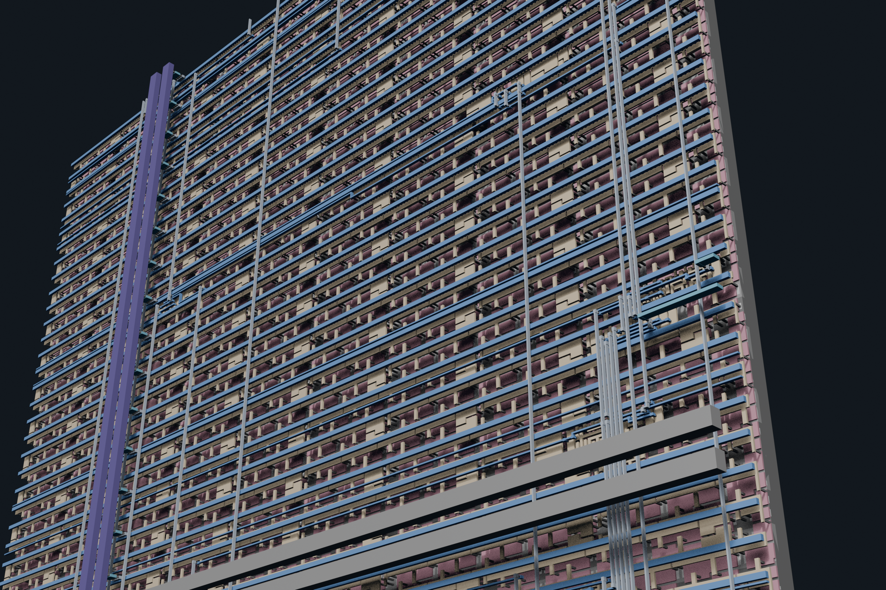
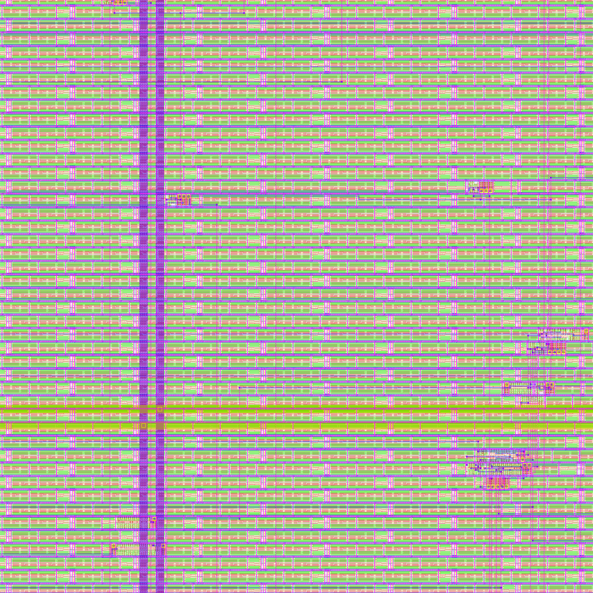
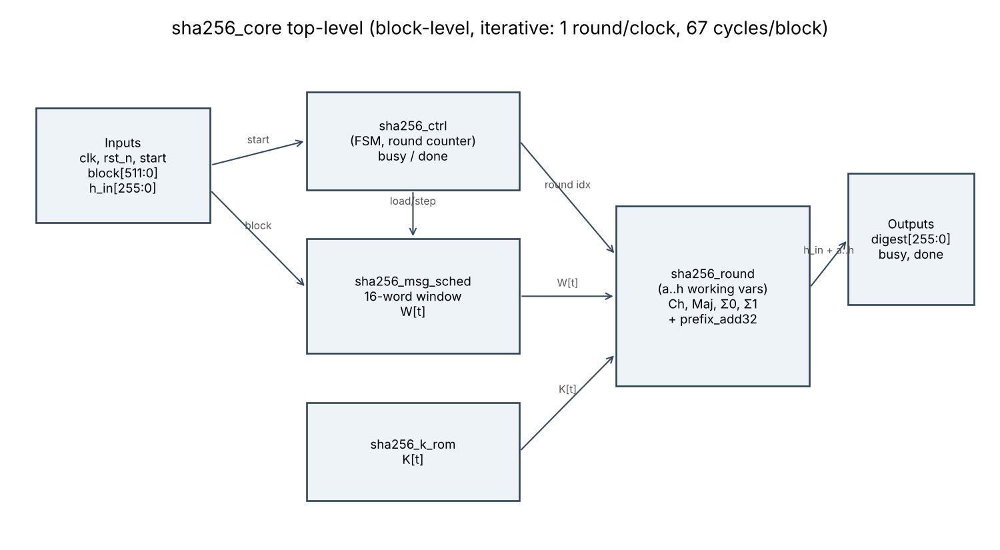
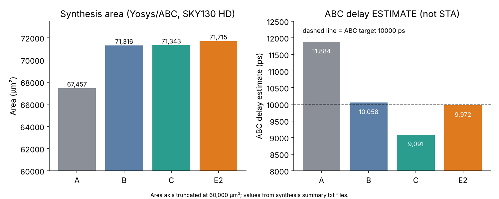
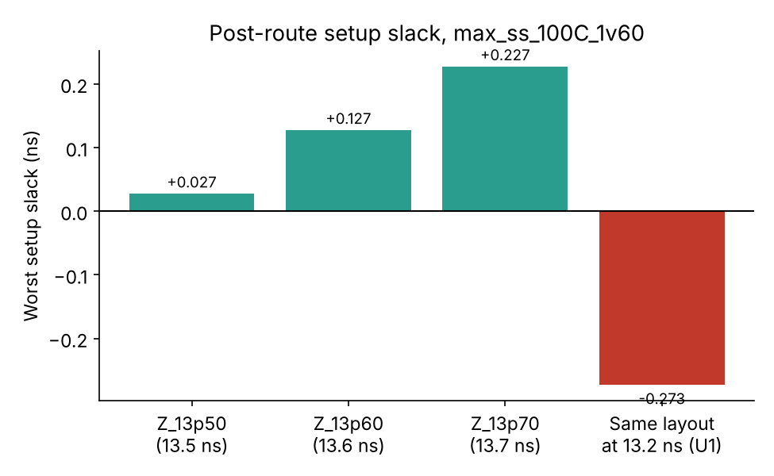
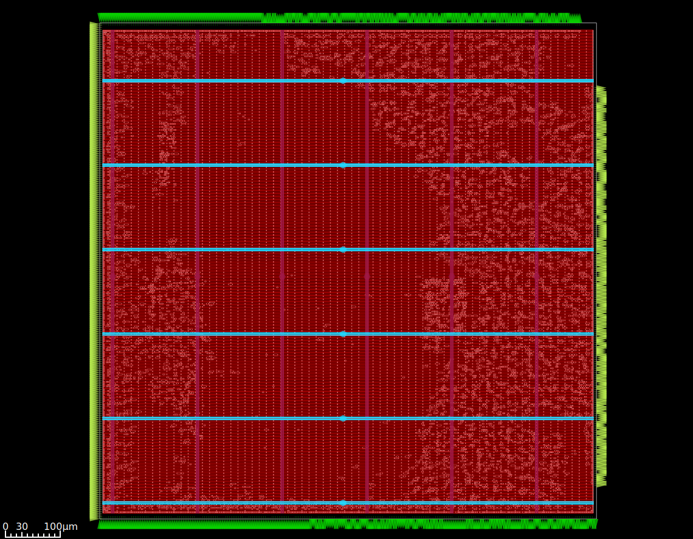

# Low-Power SHA-256 Hardware Accelerator

A hardware implementation of the SHA-256 compression algorithm using Verilog and SystemVerilog, followed by synthesis, timing analysis and physical design using the SKY130 technology.

The project explores RTL optimization, verification and ASIC implementation using an open-source EDA toolchain. A low-power implementation was an original design objective; however, the completed work does not demonstrate lower power than a baseline or alternative design.

## Chip Layout

<p align="center">
  
</p>

<p align="center">
  
</p>

## Architecture

The accelerator uses an iterative architecture, performing one SHA-256 compression round per clock cycle.

Main RTL modules:

- `sha256_core.sv` – Top-level module.
- `sha256_ctrl.sv` – Controller and FSM.
- `sha256_round.sv` – SHA-256 round operations.
- `sha256_msg_sched.sv` – Message schedule generation.
- `sha256_k_rom.sv` – SHA-256 round constants.
- `prefix_add32.sv` – 32-bit prefix adder.

The core accepts a pre-padded 512-bit message block and a 256-bit initial chaining value. Message padding and block sequencing are handled externally.



Module hierarchy: [images/rtl/module_hierarchy.png](images/rtl/module_hierarchy.png). Latency is 67 clock cycles per 512-bit block.

## Synthesis Results (pre-layout, Yosys 0.33 + ABC, SKY130 HD)

| Design | Change | Area (µm²) | ABC delay estimate |
|---|---|---:|---:|
| A | Baseline | 67,457 | 11,884 ps |
| B | Carry-save adders | 71,316 | 10,058 ps |
| C | + prefix adder in digest accumulation | 71,343 | 9,091 ps |
| E2 (final RTL) | + prefix adders in the round | 71,715 | 9,972 ps |

A to C reduces the ABC delay estimate by 23.5% for 5.8% more area. These are synthesis estimates, not static timing analysis. E2 is the RTL that was taken through physical design; its ABC estimate is slower than C's (see [Optimization](docs/optimization.md)).



## Implementation Results (post-route)

The design was synthesized using Yosys and ABC and taken through the OpenLane 2 physical-design flow using the SKY130 HD library.

The following are the two final candidates:

| Metric | Z_13p60 | Z_13p50 |
|---|---:|---:|
| Signoff clock | 13.6 ns | 13.5 ns |
| Setup slack | +0.127 ns | +0.027 ns |
| Hold slack | +0.050 ns | +0.050 ns |
| Cell area | 134,637 µm² | 134,637 µm² |
| Sustained power | 16.8 mW | 16.9 mW |
| Energy per block | 15.31 nJ | 15.29 nJ |
| Antenna nets | 0 | 0 |
| DRC / LVS | 0 / 0 | 0 / 0 |

Z_13p60 is the primary candidate because it has a larger setup margin. Z_13p50 provides slightly higher throughput at a tighter timing margin.

The reported throughput is approximately 561.9 Mbit/s for Z_13p60.



The timing results are specific to their stated signoff constraints. The implemented layout has a reported negative setup slack of approximately -0.273 ns when checked at its 13.2 ns implementation constraint.

Power values are simulation-based estimates (post-route netlist, 20 blocks, zero-delay gate-level simulation, OpenSTA with nominal SPEF at tt / 1.8 V / 25 °C), not measurements from fabricated silicon. The low-power objective was not conclusively achieved: no baseline power run was made, the estimate covers only one workload and one process corner, and the optimization campaign primarily evaluated timing and area rather than a controlled power-reduction strategy. The reported values therefore characterize this implementation; they do not establish a power improvement.

Synthesis-stage results (Yosys/ABC) are tabulated in [`results/ppa_comparison.csv`](results/ppa_comparison.csv). They are pre-layout estimates and must not be compared directly with the post-route numbers above.

## Verification

Test results from `make test` (saved in `verification/results/`): K-constant ROM 385 checks, message scheduler 406, controller 777, core 751, round unit test, and a 32-bit prefix adder with 200,000 random vectors, all PASS. Known-answer checks cover messages of 0, 3, 55, 56, 64 and 119 bytes (padded blocks supplied to the core), plus ignored start pulses and reset abort.

The Verilog/SystemVerilog RTL was tested using SystemVerilog testbenches and a C-based SHA-256 reference model.

Verification includes:

- Individual RTL module testing.
- SHA-256 core testing.
- Message scheduler testing.
- Controller and datapath testing.
- Gate-level functional verification.

The final gate-level check matched 20 out of 20 tested block digests against independently recomputed SHA-256 results.

## Physical Design

Stages completed: floorplan, placement, clock-tree synthesis, routing, STA at nine corners, Magic and KLayout DRC, Netgen LVS, GDS stream-out. Result: 0 DRC errors, 0 LVS errors, 0 antenna-violating nets, 0 slew and 0 capacitance violations. The die is 900 x 900 µm at 17.3% utilization.



More views: [full layout](images/physical_design/Z_13p60_2d_full.png), [routing layers](images/physical_design/Z_13p60_2d_metals.png). Data: [`results/`](results/).

## Limitations

- Block-level core only: no message padding, no multi-block sequencing, no initial-hash selection in hardware.
- Power was measured in simulation for one workload and one corner; no baseline-versus-final power comparison exists.
- The final design's ABC delay estimate is slower than the intermediate design C; see [Optimization](docs/optimization.md).
- Large die (900 x 900 µm, 17.3% utilization) chosen for routability, not area.

Full list: [Limitations](docs/limitations.md).

## Tools Used

- Verilog / SystemVerilog
- Icarus Verilog
- Yosys
- ABC
- OpenSTA
- OpenLane 2
- OpenROAD
- SKY130 HD PDK
- Magic
- Netgen
- KLayout

## Repository Structure

```text
rtl/              SystemVerilog source files
verification/     Testbenches, vectors, reference model, logs
synthesis/        Synthesis scripts, constraints, reports, netlist
physical_design/  OpenLane configs, reports, final GDS/DEF/LEF
results/          PPA, timing, power and area CSV files, final_results.md
images/           Architecture, synthesis, timing, layout and render images
docs/             Project documentation
scripts/          Utility scripts
```

## Running Verification

From the project root:

```bash
bash scripts/run_all_tests.sh
```

This needs `make`, `gcc`, `iverilog` and `verilator`. It builds a temporary workspace around the original Makefile, runs the C reference check, Verilator lint, and every testbench, and writes a log to `verification/results/`.

Final layout files (GDS, DEF, LEF) are in `physical_design/final_layout/`; they come from run `Z_13p50`, whose netlist, OpenROAD database and DEF are byte-identical to those of `Z_13p60` and `Z_13p70` (see [Physical Design](docs/physical_design.md)).

The synthesis and physical-design flows require the corresponding EDA tools and SKY130 PDK. Refer to `docs/references/tool_versions.md` for tool versions.

## Documentation

For more details:

- [Architecture](docs/architecture.md)
- [RTL Design](docs/rtl_design.md)
- [Verification](docs/verification.md)
- [Synthesis](docs/synthesis.md)
- [Timing Analysis](docs/timing_analysis.md)
- [Physical Design](docs/physical_design.md)
- [Power Analysis](docs/power_analysis.md)
- [Optimization](docs/optimization.md)
- [Limitations](docs/limitations.md)
- [Tool versions](docs/references/tool_versions.md)

## License

This project is licensed under the MIT License. See [LICENSE](LICENSE).
