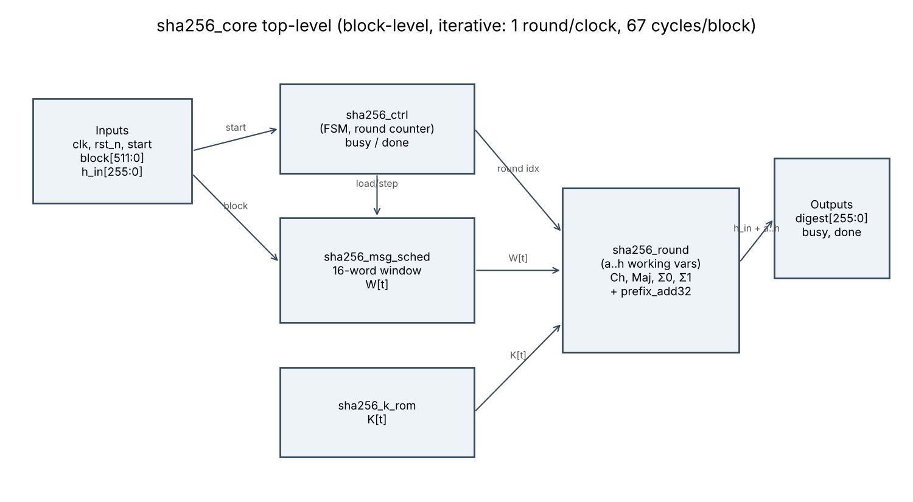
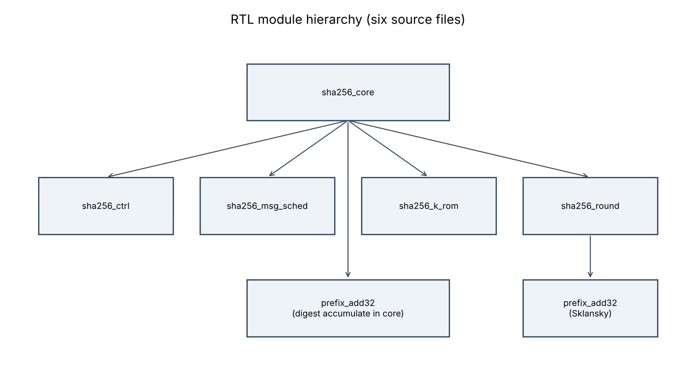

# Architecture

* **Iterative:** one round per clock; one set of round logic reused for all 64 rounds.
* **Cycle budget:** 67 cycles from one `start` to the next (done asserts 66 cycles after start; a new start is accepted on cycle 67). Measured in `pw_sim.log`: "cycles per block (start to start) = 67".
* **State:** eight 32-bit working variables a..h, a 16-word message-schedule window, round counter. 1,322 flip-flops after synthesis (`dfxtp_1`).
* **Constants:** K[0..63] in `sha256_k_rom.sv`.
* **Digest:** `h_in` words added to a..h through prefix adders (`u_acc_add` in `sha256_core.sv`).
* **Ignored `start`:** a start while busy is ignored; reset aborts the operation (both checked in `tb_sha256_core.sv`).

Module hierarchy: 
