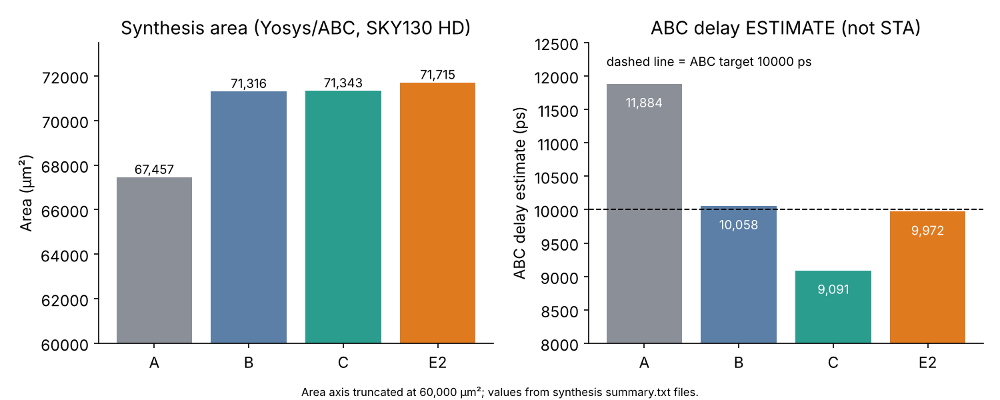

# Synthesis
Tool: Yosys 0.33, ABC with `-D 10000` (a synthesis target, not an STA constraint), liberty `sky130_fd_sc_hd__tt_025C_1v80.lib` (sha256 ec0e1067...).

| Design | Generic cells | Mapped cells | Area (µm²) | FFs | ABC delay (ps) |
|---|---|---|---|---|---|
| A | 6572 | 8871 | 67,457.1968 | 1322 | 11,884.06 |
| B | 7646 | 9374 | 71,315.8976 | 1322 | 10,057.63 |
| C | 8198 | 9509 | 71,343.4240 | 1322 | 9,091.20 |
| E2 | 8334 | 9662 | 71,715.0304 | 1322 | 9,972.04 |

**Discrepancy.** An earlier note quoted "7169 generic cells" for the baseline; the saved summary for A shows **6572**. The 7169 figure could not be traced and is not used.

The ABC delay is a no-wire, no-skew estimate and is **not** static timing analysis.
