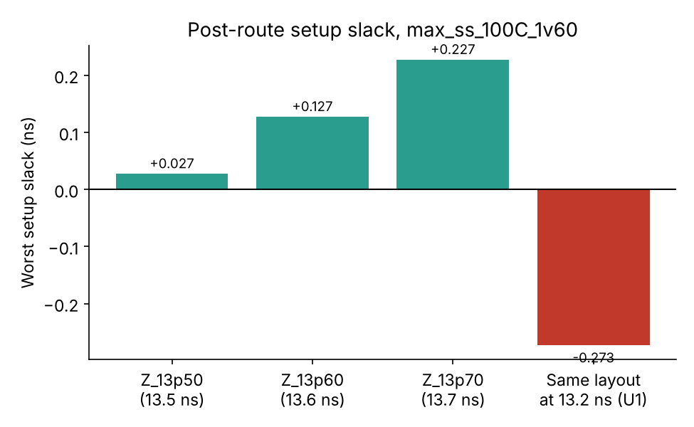

# Timing analysis
**Pre-layout:** `m4_comparison/sta_*` hold OpenSTA runs of designs A/B/C at a 10 ns clock. No pre-route STA for E2 was found -> UNVERIFIED.

**Post-route (OpenLane, 9 corners: nom/min/max x tt/ss/ff).** Limiting setup corner `max_ss_100C_1v60`; limiting hold corner `min_ff_n40C_1v95`.

| Run | Impl. SDC | Signoff SDC | Setup ws | Hold ws |
|---|---|---|---|---|
| Z_13p50 | 13.2 | 13.5 | +0.0274 | +0.0502 |
| Z_13p60 | 13.2 | 13.6 | +0.1274 | +0.0502 |
| Z_13p70 | 13.2 | 13.7 | +0.2274 | +0.0502 |
| U1 | 13.2 | 13.2 | −0.273 | — |

The three Z runs are **one layout** implemented with a 13.2 ns SDC and signed off against 13.5/13.6/13.7 ns. U1 re-checks that layout at 13.2 ns: 0.0274 − 0.3 = −0.273 ns, which accounts for the earlier independent OpenSTA "−0.27 ns max_ss" observation. The original log/SDC that printed that figure were not recovered (the `chk_signoff.tcl` on disk is not the version that produced it) -> the arithmetic reconciles, but the original print is UNVERIFIED.

Clock skew (worst, from metrics): up to ~0.77 ns at max_ss. IR drop worst 3.9 mV.
